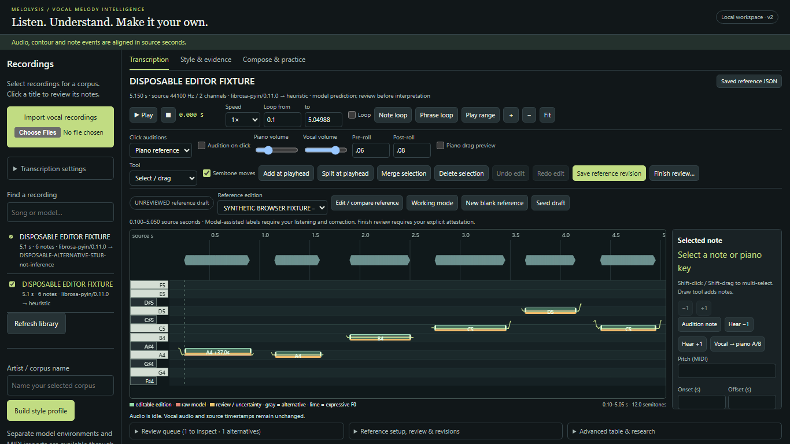
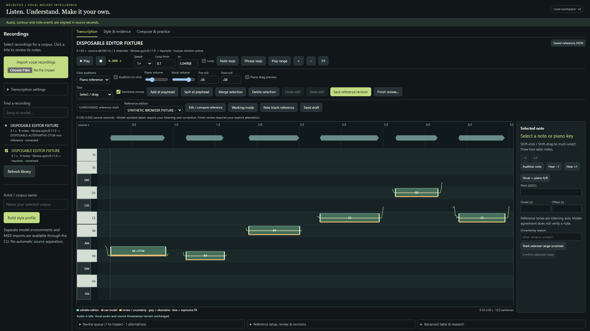

# Annotation editor validation — 2026-11-04

Historical editor milestone. The current contextual-audition/library cleanup and
its new checks are recorded in [UX_VALIDATION.md](UX_VALIDATION.md).

The DAW-style editor and dual audition are implemented in the existing workspace.
No transcription model, generator or archived benchmark result changed. The user
still supplies human musical judgments; no MHS labels were fabricated or verified.

## Actual checks

| Suite | Result | Scope |
|---|---:|---|
| Python unittest | 66 passed, 0 failures/skips | existing 61 regressions plus reference/working history restoration, stale-write rejection and path safeguards |
| JavaScript core | 11 passed, 0 failures/skips | fractional/sub-frame edits, group constraints, resize, split/merge/draw validation, atomic history, pitch naming/frequency, source padding and review rules |
| Playwright Chromium | 40 passed, 0 failures/skips/flakes | 20 interaction/audio cases at 1366×768 and 1920×1080, one worker, separate headless browser |
| Real-vocal evaluation regression | 64 records reproduce identical event P/R/F1 | both human editions, both splits, four existing systems; no new tuning/inference claimed |
| Protected-artifact hashes | 24 unchanged | original private WAV/reference, existing corrections found at audit, benchmark artifacts, generation and transcription/evaluation algorithms |

Final run details, durations, per-test status and source checksums:
[browser-validation.json](editor/browser-validation.json).
[Audio measurements](editor/audio-measurements.json),
[evaluation regression](editor/evaluation-regression.json).

Browsers ran with `--mute-audio` so speakers were undisturbed. Checks measured
actual oscillator/decoded-media signals through the production AudioContext's
post-volume analyser nodes. They are not merely mocked player events or assertions
about a moved rectangle. They do not establish acoustic device latency, human
listening quality or real-vocal transcription accuracy.

The disposable fixture is a generated stereo 44.1-kHz WAV with known harmonic
tones, analyzed by real pYIN. An explicitly named alternative stub exercises
disagreement/missing-event review behavior; it is **not** second-model inference.
All browser-created annotations are clearly named synthetic test fixtures outside
the main workspace. The tests briefly toggle attestation only to verify it clears
on edits; no purported human listening judgment is saved in those browser cases.
Existing protocol-unit fixtures remain explicitly synthetic.

## Interaction coverage

- Load model-assisted draft with model identity, original source axis and unchecked
  review state. Reference header exports the saved reference, while Working mode
  keeps its distinct MIDI/CSV/report exports.
- Move the correct note using actual pointer events; confirm underlying annotation
  remains unchanged until release. Preserve a 69.37 target when transposing and
  retain sub-frame timing. Other note IDs remain unchanged.
- Resize at source/neighbour boundaries without invalid durations/overlaps.
- Split at the source playhead, merge compatible notes without quantizing pitch,
  delete, draw missing notes and move a selection of two notes.
- Undo/redo edits and uncertain regions; Escape cancels an uncommitted gesture
  without adding history. Editing clears review attestation.
- Zoom time/pitch and pan with middle-mouse input; compare keyboard/note row
  centers after zoom. Default layouts fit the tested widths without horizontal
  page overflow. Inspector/research sections scroll independently.
- Persist and reload both reference and working corrections. Restore old editions
  as new revisions. Verify separate histories, unchanged source bytes and immutable
  raw prediction JSON after every browser case.
- Select review flags, confirm a note without verifying the whole excerpt,
  inspect alternative-only missing-event windows and constrain suggestions to a
  short reference excerpt. No automatic label insertion.
- Select a raw model note for audition in a blank reference, with read-only
  inspector; the reference remains empty and unreviewed.

## Measured audio behavior

Representative final measurements at 1366×768 (the second viewport also passed):

| Check | Requested / expected | Observed |
|---|---|---|
| Piano A4 | oscillator 440.000 Hz | spectral peak 441.431 Hz; nonzero RMS |
| Piano A♯4 | oscillator 466.163762 Hz | spectral peak 468.347 Hz; nonzero RMS |
| Fractional target | MIDI 69.37 | oscillator 449.504905 Hz, including Both and A/B |
| Original-vocal segment after saved onset edit/reload | onset 0.259433107, pre-roll 0.06; offset 0.917913832, post-roll 0.08 | segment 0.199433107–0.997913832 original source seconds |
| Both | one vocal media source plus reference bus | both bus signals nonzero; exactly one media source |
| Piano volume 0, vocal volume 0.8 | mute piano only | piano RMS 0; vocal RMS remained >0.005 |
| Both volumes 0 with transport looping | both buses muted, transport still running | measured vocal RMS <0.0001; piano gain/output muted; loop still active |
| 0.5× and 0.75× original vocal | preserve 440-Hz fixture pitch | spectral peak 441.431 Hz at both speeds; annotation arrays identical |
| A/B | original vocal then piano | media paused before piano; reference RMS >0.001, correct fractional target frequency |

An 8192-point FFT at 44.1 kHz has 5.383-Hz bins, explaining the measured peak-bin
differences from exact oscillator values. These checks use tolerances appropriate
to that resolution. A/B would have failed if it merely updated the UI: the first
prototype displayed the right frequency but produced silence because a deferred
pause event stopped the new tone. Waiting for pause before starting piano fixed
the signal-level failure.

The audio tests additionally verify pre/post-roll, source looping after edits and
reload, explicit piano fallback when Vocal mode has no matching note, whole-source
Space playback independent of audition mode, and playhead position against the
media source clock. Both shares an AudioContext; acoustic phase/sample alignment
has not been calibrated on a physical output device.

## Private recording review and limitations

Read-only browser checks loaded the actual prepared MHS draft at both screen
sizes: 11 notes, 0.500–6.500 seconds, original revision
`647f15b6ed0c499898f26a390986bcc3`, status draft, attestation false, audio paused,
no unsaved edits and no page exceptions. Private screenshots and checks are in
git-ignored `outputs/editor/`. No MHS audition was played during development.

Chrome/Windows behavior was tested; Firefox, Safari, mobile/touch behavior,
microphones, acoustic latency and perceptual time-stretch quality remain untested.
Loop/seek stopping uses media/animation events rather than sample-accurate DAW
transport. Browser `preservesPitch` is requested, not an assertion of artifact-free
singing at every speed. Missing/changed source audio fails integrity checks; codec
fallback is explicit. Large-corpus/very-long-session UI stress testing is limited.

Piano is a clean local additive reference instrument, not a sampled grand piano.
Arbitrary formant-preserving shifted-vocal preview is investigated and deferred;
moving notes alters symbolic labels only. See [usage and investigation](ANNOTATION_EDITOR.md).

Synthetic screenshots:

