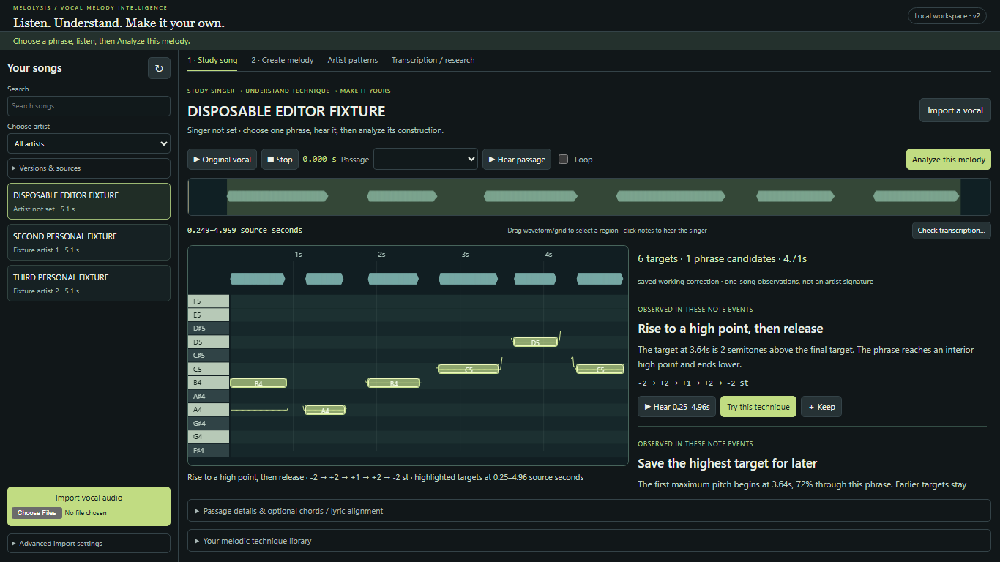
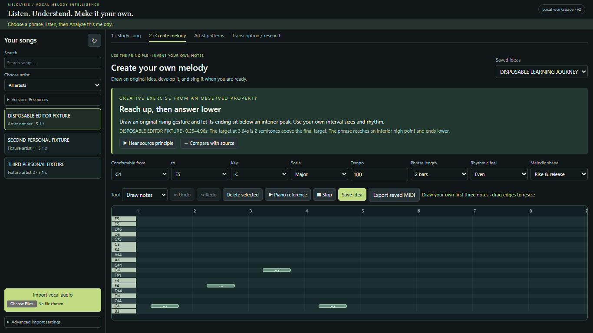

# Study a singer, understand a decision, make your own melody

This is now the default Melolysis workflow. It works with one recording and needs
no corpus, reviewed annotation, JSON editing, benchmark import or microphone.

The current application is **http://127.0.0.1:8775/**. Older servers do not hot-reload
Python routes; the previous server/browser was left undisturbed. Start later with:

```powershell
.\.venv\Scripts\python.exe main.py serve --output outputs --port 8775
```

## A complete MHS journey

1. [Open MHS Chorus](http://127.0.0.1:8775/?analysis=5fb48b6259d2a98d40c651bcbe3ea15420284cd49d9e6a8a62cd4deae598cf6e).
   Alternatively choose it from Your songs. The app selects the first phrase with
   at least three extracted targets; you can choose another or drag a time region.
2. **Hear passage**, then **Analyze this melody**. The current saved working
   transcription has six targets in the first phrase, **0.668–4.190 seconds**.
3. One computed observation is **Rise to a high point, then release**: the interior
   target at about **1.20 seconds** is **three semitones above the final target**.
   Its extracted interval pattern is **+8, −3, −2, −3, +5 semitones**. This describes
   the saved note events; it is not independent proof of the singer's true targets
   or an artist-wide habit. Click Hear to highlight the evidence and hear the vocal.
4. **Try this technique** opens a blank, independent idea. The instruction is to
   invent an upward gesture with an ending below its interior peak, using your own
   interval sizes and rhythm. Source pitches are not seeded into the canvas.
5. Draw several notes, drag bodies/edges to edit, use Undo/Redo, audition piano and
   explore variations of your motif. Check the technique, save and export MIDI.

A separate **Demonstration · my rising phrase and lower ending** idea was drawn
and edited through actual browser gestures, saved and exported. Its pitches are
C4–D4–F4–E4–G4–F4, with a later high point and a lower ending. It illustrates a
general structural decision rather than reproducing MHS's extracted intervals.
This is an automated interaction demonstration, not a human performance or proof
of legal originality. [Open the saved demonstration](http://127.0.0.1:8775/?analysis=5fb48b6259d2a98d40c651bcbe3ea15420284cd49d9e6a8a62cd4deae598cf6e&idea=dcf65105c01c4875ab9234e6c92fafea).

For a two-phrase comparison, select **0.500–6.500 seconds** under Passage details,
analyze again, then open **Compare phrases A/B**. The working transcription has
11 events across two phrase candidates. The views normalize starting pitch, while
audio plays the original untransposed recording. In this passage the comparison
is explicitly **not an established recurring motif**; note counts and interval
patterns differ. A/B does not invent a repetition claim.

## What changed and what was reused

The [gap audit](PRODUCT_GAP_AUDIT.md) records the earlier disconnect: transcription
was the opening task, Style required corpus selection, and composition used raw
parameter forms/JSON without a passage-specific learning link or saved edited MIDI.

| Reused musical infrastructure | New learning connection |
|---|---|
| `features.analyze_notes` | Selected-passage contour, target range, peak/low placement, durations, gaps, steps, repeated targets and optional harmonic context explained in ordinary language |
| `motifs.discover_motifs`, relative representations, sequence distance/variation | Candidate recurrence explanations, timestamped examples, interval patterns and audible/visual phrase comparison |
| `corpus.profile_artist` | Separate Artist patterns workspace, explicit one-song limitation and links back to song study |
| `editor-core.js` validated operations/history | Independent beat-based idea drawing, selection, movement, resizing, deletion and undo/redo |
| Original media element, `VocalAudition`/Web Audio buses | Source-note/phrase listening, looping, A/B and scheduled local piano references for user ideas |
| `motifs.source_similarity` | Transposition-invariant interval/duration resemblance flags against source phrases, with short-material non-assessment stated |
| `pipeline.export_notes` | Export of the actual saved, edited idea at its chosen tempo |
| Existing annotation/editor/evaluation APIs | Preserved under Transcription / research, independent of all learning snapshots and idea revisions |

No new ML model or dependency was introduced. Existing pitch/transcription,
feature/motif extraction, corpus algorithms, statistical generator and frozen
benchmarks were not rewritten. The previous constrained generator remains under
Advanced; the primary composition path transforms **user-entered material**.

## Song scope, artist scope and evidence

One song supports immediate passage study, timestamped examples, bookmarkable
techniques and linked composition. A whole-song or multi-phrase selection can
compare its phrases and candidate motifs. It never becomes evidence that an artist
always uses a technique.

Artist patterns requires selected songs to compare material across a singer's
corpus. Existing equal-song aggregation, support counts, section comparisons and
cross-song motif candidates remain available. With one selected song, the page
still shows its findings but explicitly asks for additional songs before discussing
recurrence. Convenience samples and lack of a population baseline limit artist
specificity even with multiple songs. Research recordings remain separately
classified and excluded unless explicitly enabled.

Each learning finding carries a source hash, prediction/correction identity, note
fingerprint, exact time bounds, target IDs, intervals, durations, category and an
exercise. Categories distinguish measured event properties, similarity candidates
and musical interpretations. The exercise is a **creative suggestion**, not an
emotional explanation. No reviewed human reference is created by studying or
bookmarking a technique.

Source chords require existing annotations or explicit user input. Optional simple
symbols such as `C | Am | F | G7` require a user-confirmed tempo and beat origin;
each symbol covers one 4/4 bar. Chord membership/passing-neighbour candidates do
not establish harmonic function or emotional tension. Optional syllable slots
assume user-supplied one-target-per-slot alignment; `*` marks user stress. There
is no lyric recognition, automatic syllabification or automatic melisma alignment.

## Composition workspace

- Choose a comfortable range by note name, key/scale, tempo, phrase length,
  rhythmic feel and intended shape. The current guided workspace uses 4/4 beats.
- Draw on the grid; drag a body to move and an edge to resize. Default timing
  snaps to quarter-beat increments; Alt permits fine timing/pitch. Shift-click
  selects a group. Piano keys and note selection audition local reference tones.
- **Explore variations of my motif** offers changed durations, a different ending,
  and repetition with a changed answer. All variants start from your notes. You
  choose which one to adopt; that operation participates in Undo/Redo. Repeated
  development maintains unique event identities.
- **Check this technique** reports range/scale and the chosen exercise constraints,
  shape/feel goals, optional own-chord/lyric relationships and source resemblance.
  Feedback is recomputed after editing. It does not rate songwriting quality.
- **Save idea** appends an independent revision. **Export saved MIDI** uses that
  edited revision, not an earlier generated candidate. Further edits hide the
  export link until saved again. Saved ideas reload from the picker or URL.
- **Hear source principle / Compare with source** retains the actual source link
  without merging its notes into the idea. No microphone is required.

The optional singing stage compares a transcribed attempt with a saved intended
idea. First onsets are aligned, intended tempo is fixed, and event precision/recall,
onset/offset errors and ordered contour directions are measured. Different note
counts prevent a simple ordered contour-agreement claim. Review the attempt's
transcription before interpreting the feedback. New microphone-device/perceptual
performance testing was not performed; synthetic comparison contracts were tested.

## Independent persistence

Under the selected output root:

| Location | Content |
|---|---|
| `learning/studies/<hash>.json` | Immutable, deterministic passage snapshot keyed by source/note edition, selection, context and teaching-method version |
| `learning/techniques/<finding-hash>.json` | Explicit bookmark containing source evidence, conditions and an exercise |
| `learning/ideas/<id>/revisions/<revision>.json` | Independent original-idea edition in quarter-note beats, source-study link, configuration and assessment |
| Same revision `.mid` / `.csv` | Exported seconds at the idea's tempo; MIDI pitches follow the existing semitone export convention |
| `learning/ideas/<id>/current.json` | Current saved edition; stale saves are rejected and previous revisions remain |

These directories do not participate in reference manifests, corpus inclusion or
model training. A later source correction produces a new study fingerprint; saved
techniques retain their earlier snapshot. Undo history is per session; persisted
idea revisions survive reload. Original audio and reference/correction stores stay
independent. Fractional pitches remain in JSON/CSV; MIDI export does not reproduce
continuous vocal bends.

## Verified results

- **87 Python tests passed**, including 15 new study/idea contracts: exact evidence,
  absence of unsupported claims, clipping/source time, confidence states, phrase
  boundaries, transposed motif candidates, explicit harmony/lyric context, input
  immutability, own-motif development, repeated-development IDs, resemblance,
  edited MIDI timing/pitches, stale saves, immutable snapshots and attempt alignment.
- **11 JavaScript editing/core tests passed.**
- **72 Playwright Chromium checks**: 58 existing annotation/audio regressions plus
  14 new learning interactions at **1366×768 and 1920×1080**. The new cases exercise
  the complete journey, measured source/piano audio, edited revision persistence
  and MIDI, empty/insufficient-note states, bookmarks, direct edits/history,
  one-song artist scope, source selection and actual A/B routing.
- **64 stored real-vocal comparisons re-scored identically**; frozen manifests and
  **143 protected files** unchanged. This is not a new inference/accuracy claim.
- Real MHS capture verified audible source and piano buses, six independent drawn
  targets, a saved edited MIDI response, both sizes, no runtime exceptions/page
  overflow, and no correction/reference/generator/inference POST mutations.

Machine-readable results are in [browser-validation.json](learning/browser-validation.json),
[audio-measurements.json](learning/audio-measurements.json) and
[evaluation-regression.json](learning/evaluation-regression.json). The final isolated
browser run is the reported result; an intermediate overlapping runner invalidated
a trace artifact and was discarded.

## Screenshots and reproduction

Real MHS screenshots stay local/git-ignored in `outputs/learning-demo/`:
`mhs-study-1366x768.png`, `mhs-study-1920x1080.png`,
`mhs-compare-1366x768.png`, `mhs-compare-1920x1080.png`,
`mhs-create-1366x768.png`, `mhs-create-1920x1080.png`.
`journey-checks.json` records source identities, audio signals, saved revision and
protected-data checks. No MHS reference was edited or attested.

Shareable screenshots show disposable synthetic fixtures:





```powershell
.\.venv\Scripts\python.exe -m unittest discover -q
npm run test:editor
npm run test:browser
# Run one browser-test process at a time (shared fixture port/artifact directory).
.\.cache\model-env\Scripts\python.exe tools/check_editor_integrity.py --snapshot .cache/learning/protected-before.json --output .cache/learning/evaluation-regression.json
node tools/archive_editor_validation.cjs --learning
node tools/capture_learning_journey.cjs
```

The integrity snapshot and real-demo configuration are session artifacts. Normal
use needs only Python and a modern browser; Node/Playwright are development tools.

## Remaining limits

Transcription is still the limiting evidence: MHS has no independently reviewed
human truth. Its new explanations were checked against saved events and actual
audio routing, not independently validated by a musician. Rest-based phrases,
partial-phrase selection, target confidence and short fragments can change the
interpretation. No automatic section/lyric/harmony/emotion inference was added.
Motif matching is bounded and candidate-based; general teaching rules are explicit
heuristics, not statistically proven artist-specific discoveries.

Resemblance uses relative intervals and duration-ratio windows of four or more
targets within source phrases. Common short gestures may flag; missing/altered
patterns can escape it. It does not establish legal originality. No perceptual
songwriting-quality/usability study or speaker/device-latency calibration was
performed. Browser scheduling/time stretching can introduce audible artifacts;
vocal retuning/formant preview is still absent. Guided harmony currently supports
simple triads/sevenths on a supplied 4/4 grid; advanced meter and detailed lyric
alignment remain future work. Corpus-specific technique prevalence and comparisons
against wider popular-music baselines still need more validated songs.

## Changed implementation files

`src/learning.py`, `src/learning_store.py`, `src/workspace.py`,
`src/web/learning.js`, `src/web/learning-roll.js`, `src/web/learning.css`,
`src/web/app.js`, `src/web/audition.js`, `src/web/library.js`,
`src/web/index.html`, `tests/test_learning.py`, `tests/browser/learning.spec.cjs`,
`tools/editor_test_server.py`, `tools/capture_learning_journey.cjs`,
`tools/check_editor_integrity.py`, `tools/archive_editor_validation.cjs`, README
and the new product audit/learning documentation and validation artifacts.
