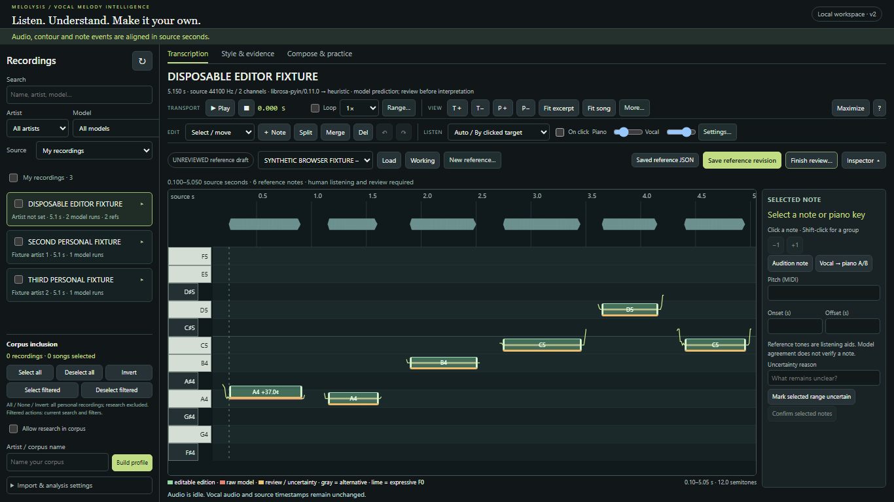
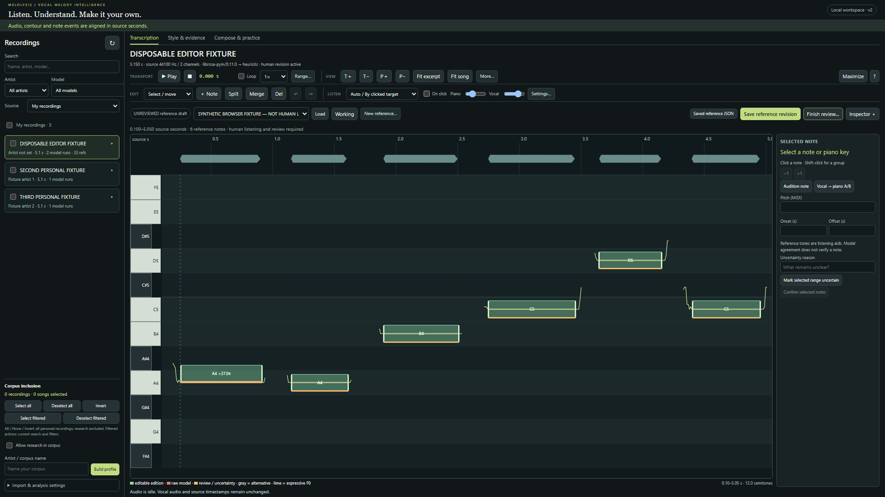

# Contextual audition and workspace validation — 2026-11-04

The updated application is running at **http://127.0.0.1:8774/**. The previous
server/browser was left alone. [Open the prepared MHS draft](http://127.0.0.1:8774/?analysis=5fb48b6259d2a98d40c651bcbe3ea15420284cd49d9e6a8a62cd4deae598cf6e&reference=137e4f16e5b3425d91367adc0169eaf3).
For a later session, run:

```powershell
.\.venv\Scripts\python.exe main.py serve --output outputs --port 8774
```

## Implemented behavior

- **Auto / By clicked target**, with **On click** enabled by default: editable
  working/reference notes and raw model events audition original vocal segments.
  Piano keys always audition their clean reference pitch in Auto/Piano/Vocal/Both;
  the previous search for unrelated matching vocal notes is removed. Manual note
  overrides, A/B, looping, independent volumes and source-time pre/post-roll remain.
- Grouped Transport, View, Edit and Listen toolbars; secondary controls in
  popovers; shortcut dialog; a consistent Save/Finish review toolbar and Maximize.
- A collapsed, resizable bottom inspector with Review queue, History/revisions
  and Advanced/research tabs. Existing comparison/export/metadata functions remain.
  Inspector resizing no longer propagates arrow keys into note transposition.
- First reference load fits its exact excerpt and relevant reference/prediction
  pitches. The old minimum-15-second working viewport no longer carries into a
  reference, and initialization occurs before asynchronous reference-list loading.
  Per-edition deliberate zoom/pan is retained within the session. Explicit Fit
  excerpt, Fit song, Fit selected notes and Reset pitch view remain separate.
- Library cards group actual source hashes, preserving every model run, working
  edition and independent reference. Artist/model/search/category filters and
  expandable versions replace the flat analysis list. In the real workspace,
  **59 analyses remain accessible under 9 recording groups**.
- Corpus selection starts empty. All/None/Invert act on eligible recording hashes
  across filters; filtered actions act on current matches. Category checkboxes are
  tri-state. Opening recordings and including them in a corpus are separate actions.
  Browsing a model does not silently change that recording's corpus-analysis choice.
- Research source provenance, including published references and legacy Vocadito
  records, is segregated. Workspace corpus endpoints require explicit boolean
  research opt-in, check other model editions of the same source, and report scope
  and warnings. No files or reference editions are consolidated.

## Measured validation

| Check | Actual result |
|---|---|
| Python unittest discovery | **72 passed**, no failures/skips |
| JavaScript edit/core tests | **11 passed**, no failures/skips |
| Playwright Chromium | **58 passed**, no failures/skips/flakes; 29 cases at each requested size |
| Browser runtime exceptions | None in the passing interaction run or real-draft captures |
| Stored real-vocal evaluation | **64 records re-scored; every scoring output identical** |
| Protected files | **127 SHA-256 checks unchanged**, including original audio, raw predictions, all existing reference/correction files, frozen evaluations and model/generation code |

The [complete browser results](ux/browser-validation.json) record case names,
durations, viewports and source hashes. They cover direct editing, source-bound
resize, multi-select, uncertainty, every editing operation's undo/redo, persisted
edits/revision restore, working/reference separation, Auto and overrides, keyboard
alignment, zoom/pan, initial framing, retained views, tabbed/resized inspector,
maximization, corpus selection without interrupting audio or losing dirty edits,
filtering, preserved versions, and UI/API research exclusion.

Tests use a disposable fixture server on 8772, actual synthetic WAV decoding/pYIN,
and explicitly labeled alternative/library contract stubs. The simulated dataset
record is **not actual Vocadito** and has no fabricated human labels. Expected
research-policy rejection is an intentional HTTP 400, not a runtime exception.

### Audio signal checks

[Audio measurements](ux/audio-measurements.json) contain **16 captured signal and
transport records** across both resolutions. Web Audio analysers measure decoded
vocal and generated reference buses before the speaker-muted output. Representative
1366×768 results:

| Action | Measurement |
|---|---|
| A4 keyboard | 440.000-Hz oscillator; 441.431-Hz FFT peak; RMS 0.0162 |
| A♯4 keyboard | 466.163762-Hz oscillator; 468.347-Hz FFT peak; RMS 0.0150 |
| Auto annotation click | Original vocal; 0.189433107–0.997913832 source seconds; RMS 0.1276; no piano tone |
| Keyboard under all four modes | A4 piano, no vocal segment, paused media, unchanged source position |
| Vertical drag | Proposed MIDI 70.37 → 476.233857-Hz tone; 479.114-Hz FFT peak; source paused; symbolic edit committed only on release |
| Saved/reloaded boundary edit | Original vocal segment 0.199433107–0.997913832, matching edited onset with 60/80-ms roll |
| Both | One vocal media source; both buses nonzero; independently muting piano then vocal drives each bus below 0.0001 RMS without stopping the loop |
| 0.5× / 0.75× vocal | 441.431-Hz peak retained on the 440-Hz fixture; original annotation timestamps unchanged |

FFT size is 8192 at 44100 Hz (about 5.38 Hz per bin); spectral peaks are not claims
of exact sub-bin measurement. Oscillator targets and nonzero output are checked
separately. A/B plays the original segment then piano. Whole-song playback remains
original audio; changing mode/corpus selection does not interrupt it.

### Real MHS view, read-only

Both 1366×768 and 1920×1080 captures verified:

- Reference bounds **0.500–6.500 seconds**, all **11 events visible**; pitch view
  low 49.5/span 15 semitones; no horizontal page overflow.
- Bottom inspector initially collapsed; piano-roll heights about 439 / 749 px.
- Reference `137e4f16e5b3425d91367adc0169eaf3`, revision
  `647f15b6ed0c499898f26a390986bcc3` unchanged; still **draft**, not attested,
  not dirty. No vocal playback or save was performed during capture.

Private screenshots and machine-readable capture checks remain git-ignored:

- `outputs/ux/mhs-1366x768.png`
- `outputs/ux/mhs-1920x1080.png`
- `outputs/ux/mhs-history-1366x768.png`
- `outputs/ux/mhs-history-1920x1080.png`
- `outputs/ux/read-only-review-checks.json`

Shareable screenshots below show disposable fixtures only:





## Reproduce

```powershell
.\.venv\Scripts\python.exe -m unittest discover -q
npm run test:editor
npm run test:browser
# Session integrity check: requires the existing protected-before snapshot and
# installed evaluation environment; reads frozen references/stored predictions.
.\.cache\model-env\Scripts\python.exe tools/check_editor_integrity.py
node tools/archive_editor_validation.cjs --contextual
# Read-only real-draft capture; uses .cache/ux/mhs-open.json from this session.
node tools/capture_contextual_editor.cjs
```

Installation, review steps and shortcuts are in [ANNOTATION_EDITOR.md](ANNOTATION_EDITOR.md).
The [evaluation regression](ux/evaluation-regression.json) records the unchanged
scientific results. This was a UI/routing change; it claims no new transcription
accuracy or independently reviewed MHS ground truth.

## Files changed

| Files | Purpose |
|---|---|
| `src/web/audition.js` | Auto note routing; unconditional clean keyboard pitch |
| `src/web/editor.js` | View initialization/cache, explicit fits, tabs/resize/maximize, settings/shortcuts |
| `src/web/app.js` | Reference/library integration, asynchronous load ordering, source-level corpus inputs |
| `src/web/index.html`, `src/web/style.css` | Grouped toolbars, compact inspector and library layout |
| `src/library.py`, `src/web/library.js`, `src/workspace.py` | Non-destructive source grouping, filters, scoped selection and workspace corpus policy |
| `tests/test_library.py`, `tests/browser/editor.spec.cjs` | Source-policy and interaction/audio regression coverage |
| `tools/editor_test_server.py` | Additional explicitly synthetic source/library fixtures |
| `tools/capture_contextual_editor.cjs`, `tools/check_editor_integrity.py`, `tools/archive_editor_validation.cjs` | Read-only captures, exact scoring regression and artifact archival |
| `README.md`, `docs/ANNOTATION_EDITOR.md`, `docs/EDITOR_VALIDATION.md`, this document, `docs/ux/*` | Current instructions, results and preserved historical milestone link |

## Limits

Headless signal checks do not calibrate acoustic latency or establish perceptual
quality on real singing. Browser frame scheduling can overshoot loop boundaries;
time stretching varies by browser/device. Vocal pitch shifting/formant preview
remains unimplemented. Deliberate audition clicks replace the preceding audition.
Corpus choice and viewport memory are per-page-session; saved notes/revisions use
the existing explicit Save paths. Grouping is content-based, so different encodings
of one take remain separate recordings. Song counts use supplied artist/song
metadata and are not inferred identity. Large-corpus UI stress and other browser
engines were not newly validated. The user's MHS draft still needs human review.
